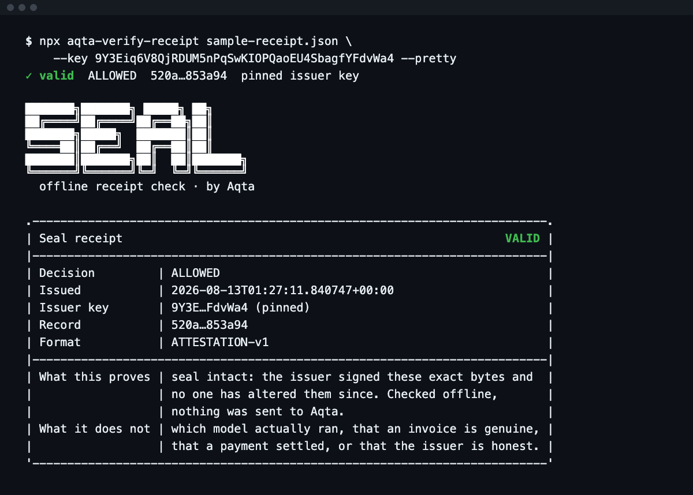
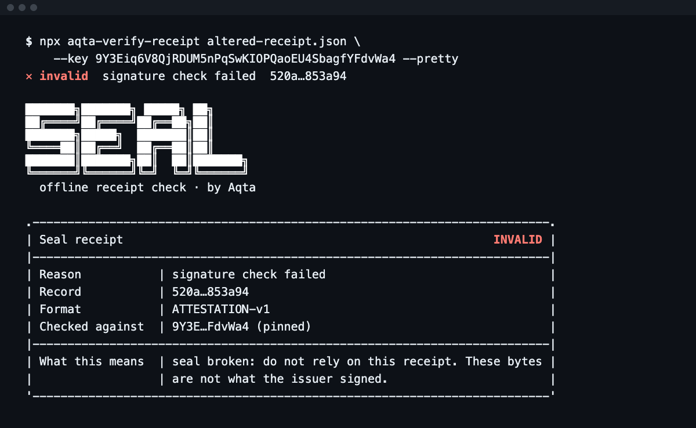

<p align="center">
  
</p>

# aqta-verify-receipt

[](https://pypi.org/project/aqta-verify-receipt/)
[](https://www.npmjs.com/package/aqta-verify-receipt)
[](LICENSE)

**Check what an AI was allowed to do, without trusting the company that ran it.**

Seal signs each AI decision that passes through it, at the moment it happens: model calls and agent actions, refusals included. This package checks those signed records on your own machine. No account, no call to Aqta. Change one field and the check fails.

## Try it in 10 seconds

```bash
curl -sO https://app.aqta.ai/samples/sample-receipt.json
pip install aqta-verify-receipt
aqta-verify-receipt sample-receipt.json --key 9Y3Eiq6V8QjRDUM5nPqSwKIOPQaoEU4SbagfYFdvWa4
# ✓ valid  ALLOWED  520a…853a94  pinned issuer key
```

Now change `"outcome"` in the file and run it again:

```text
✕ invalid  signature check failed  520a…853a94
```

## Try it in one line

```bash
npx aqta-verify-receipt receipt.json --key <issuer key> --pretty
pipx run aqta-verify-receipt receipt.json --key <issuer key> --pretty
```

`--pretty` prints the compact line, then a card that says what the check proves and what it does not. It never changes the verdict or the exit code. On the sample receipt above:



And on a copy with `"outcome"` changed:



## Why it exists

- A log is kept by whoever runs the system. A signed record can be checked by anyone else, offline, against a published key.
- Two verifiers, written separately: this one and the TypeScript (npm) one. They must return the same verdict on every published test vector.
- In use: [Authority Arena](https://arena.aqta.ai), an open evaluation of 21 AI models, checks all 1,529 of its signed records with this package.

## 30-second check

```bash
pip install aqta-verify-receipt
aqta-verify-receipt receipt.json \
  --key 9Y3Eiq6V8QjRDUM5nPqSwKIOPQaoEU4SbagfYFdvWa4
```

Default output is one compact line (words carry meaning; colour is optional):

```
✓ valid  ALLOWED  2d41…871e94c  pinned issuer key
```

Invalid:

```
✕ invalid  signature mismatch  2d41…871e94c
```

Optional human-readable card (the compact line and exit code are the result;
`--pretty` prints that same line first, so `head -1` still gives it, then the
card, which says what the signature proves and what it does not):

```bash
aqta-verify-receipt receipt.json --key <pinned> --pretty
```

```
✓ valid  BLOCKED  0000…000002  pinned issuer key

███████╗███████╗ █████╗ ██╗
██╔════╝██╔════╝██╔══██╗██║
███████╗█████╗  ███████║██║
╚════██║██╔══╝  ██╔══██║██║
███████║███████╗██║  ██║███████╗
╚══════╝╚══════╝╚═╝  ╚═╝╚══════╝
  offline receipt check · by Aqta

.--------------------------------------------------------------------------.
| Seal receipt                                                       VALID |
|--------------------------------------------------------------------------|
| Decision         | BLOCKED                                               |
| Issued           | 2026-04-23T10:15:30.000000+00:00                      |
| Issuer key       | alWz…7oix4E (pinned)                                  |
| Record           | 0000…000002                                           |
| Format           | ATTESTATION-v1                                        |
|--------------------------------------------------------------------------|
| What this proves | seal intact: the issuer signed these exact bytes and  |
|                  | no one has altered them since. Checked offline,       |
|                  | nothing was sent to Aqta.                             |
| What it does not | which model actually ran, that an invoice is genuine, |
|                  | that a payment settled, or that the issuer is honest. |
'--------------------------------------------------------------------------'
```

The header is block letters and the card frame is plain ASCII. When the
terminal is not UTF-8, when `NO_UNICODE` is set, or with `--ascii`, the header
becomes plain ASCII letters and so does every mark. The card fits an 80-column
terminal, carries no colour when piped or under `NO_COLOR`, and never changes
the exit code or the verdict. `scripts/pretty-interop-sweep.mjs` compares it
across both reference CLIs on every vector.

Or pipe:

```bash
curl -sS https://api.aqta.ai/v1/receipts/YOUR_RECEIPT_ID/public | aqta-verify-receipt - \
  --key 9Y3Eiq6V8QjRDUM5nPqSwKIOPQaoEU4SbagfYFdvWa4
```

| Exit | Meaning |
|------|---------|
| `0` | valid |
| `1` | invalid |
| `2` | usage / IO |

Current production key id: `aqta-att-01269bb4b6a7d950`
([`/v1/attestation/public-key`](https://api.aqta.ai/v1/attestation/public-key)).

Pin that string; do not re-fetch it inside a verify loop. Keys rotate and
receipts do not: a receipt verifies against the key current when it was
signed, and the permanent key record (with retired keys and their validity
windows) is at
[`app.aqta.ai/security/issuer-keys.txt`](https://app.aqta.ai/security/issuer-keys.txt).

## Library

```python
from aqta_verify_receipt import verify_receipt, fetch_published_public_key

# Once per environment: fetch, then pin somewhere you control.
trusted = fetch_published_public_key()

result = verify_receipt(receipt, trusted_public_key=trusted)
if not result.valid:
    raise ValueError(result.reason)
```

## CLI

```
aqta-verify-receipt <file|-> --key <base64url> [--no-strict] [--json] [--pretty] [--ascii] [-q]
aqta-verify-receipt <file|-> --integrity-only [--no-strict] [--json] [--pretty] [--ascii] [-q]
```

| Flag | Meaning |
|------|---------|
| `--key` | Pin the issuer key. Required unless `--integrity-only`. |
| `--integrity-only` | Signature vs embedded key only; returns untrusted. Anyone can self-sign. |
| `--no-strict` | Allow unknown top-level fields |
| `--json` | One JSON object on stdout |
| `--pretty` | Optional human-readable card after the compact line |
| `--ascii` | Plain ASCII output: no block letters or Unicode marks |
| `-q` | Silent; exit code only |

`NO_COLOR=1` disables colour and `NO_UNICODE=1` gives plain ASCII output. Meaning never depends on colour alone.

Pinning is required by default. Without `--key`, pass `--integrity-only`
(embedded key only; anyone can self-sign; result is marked untrusted).

## Dependencies

`cryptography` (>= 42) for constant-time Ed25519. Nothing else.

## Chain profile (draft)

GRANT-v1 and USE-v1 are **draft specifications, not frozen**; their wire
formats may change. `--profile chain` checks a bundle of GRANT-v1 approvals,
USE-v1 records and the ACTION-v1 records they authorised, and returns `PASS`,
`FAIL` or `INCOMPLETE`. Missing evidence is `INCOMPLETE`, never `PASS`, and
without `--approver-keys` an authorised action is `INCOMPLETE`.

```bash
aqta-verify-receipt bundle.json --profile chain --key <issuer key> --approver-keys <k1,k2>
```

Exit 0 `PASS`, 1 `FAIL`, 3 `INCOMPLETE`, 2 usage or IO. `--key` is required;
`--integrity-only` and `--no-strict` are refused. Library:
`from aqta_verify_receipt import verify_chain`, then
`verify_chain(bundle, trusted_public_key=..., approver_keys=[...])`.
Opt-in only: nothing selects this profile from a record's shape. The two
separately written verifiers, this one and the TypeScript one, must return the
same verdict and reason on every vector in
[`test-vectors/chain/`](https://github.com/Aqta-ai/attestation-spec/tree/main/test-vectors/chain).

## Transparency proofs

A receipt signature answers what the issuer asserted. It cannot answer whether
that entry is in the issuer's log, or whether the log has only ever grown.

```python
from aqta_verify_receipt import verify_inclusion_proof, verify_consistency_proof

result = verify_inclusion_proof(proof)
if not result.valid:
    raise ValueError(result.reason)
```

RFC 6962 inclusion and consistency verification, plus the signed-tree-head
signature. Written separately from the TypeScript implementation rather than
ported, and checked against the transparency vectors in the repository.

An inclusion proof establishes that what you were shown is genuinely in the
log. It does not establish that what you were **not** shown is irrelevant.
That is omission, and it is open.

## Scope

A small offline verifier for signed Seal records and their log proofs. It
reads a record and a key, and reports a verdict. It does not store, send or
host records, and it never contacts Aqta.

## Licence

Apache-2.0. Aqta Technologies Limited.

If you implement or cite the ATTESTATION-v1 format itself, credit under
CC-BY-4.0: see the repo [CITATION.cff](https://github.com/Aqta-ai/attestation-spec/blob/main/CITATION.cff).
